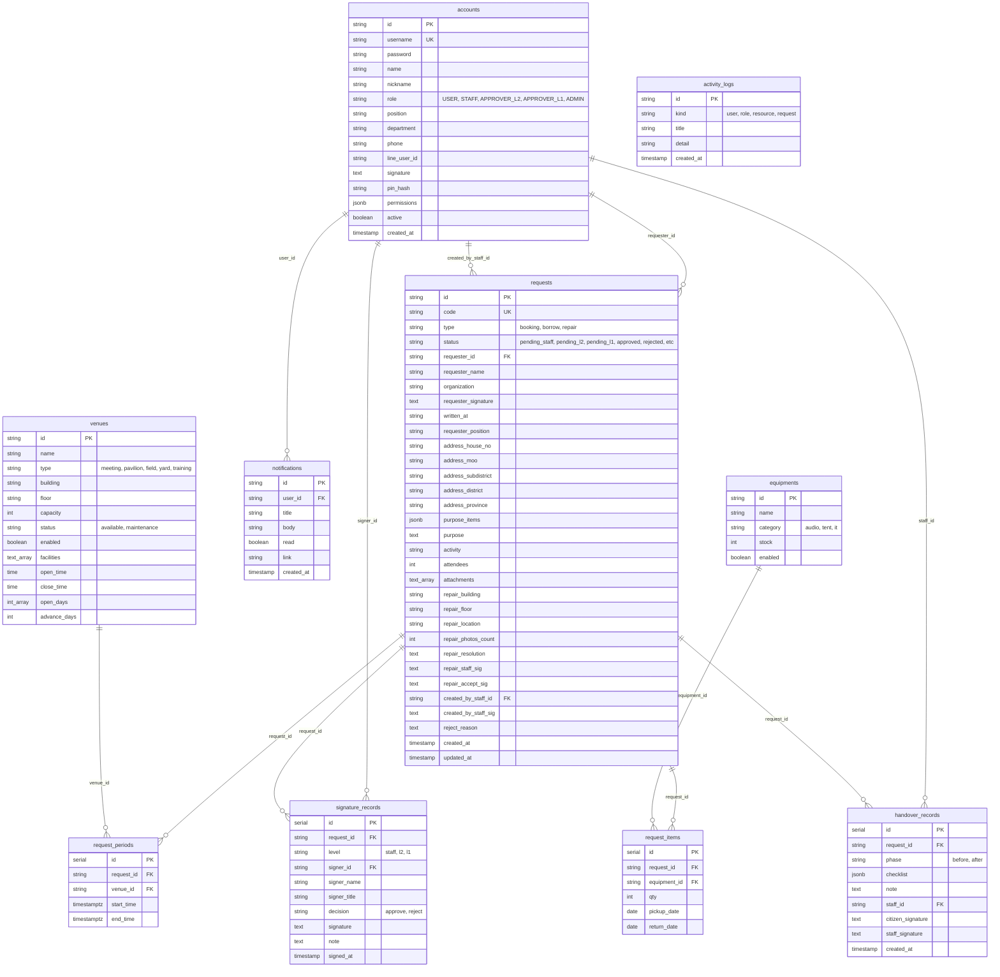

# Jongwen · ระบบจองสถานที่ ยืม–คืนครุภัณฑ์ และแจ้งซ่อม ผ่าน LINE OA (Monorepo)

แปลงจากต้นฉบับ `booking-uiux_jongwen_17 (5).html` เป็น **Web Monorepo** ด้วย **Next.js + NestJS + Tailwind CSS + Shared Mock Data (`mockDataAccount`)**
*(ไม่รวมส่วน **Design Tokens**, **ตั้งค่าการแสดงผล** และตัดส่วน **รายงาน (`/reports`)** ออกตามข้อกำหนด)*

---

## โครงสร้าง Monorepo

```text
BookingV1/
├── packages/
│   └── shared/                 # @jongwen/shared — Types, Labels, Logic และ Mock Data
│       └── src/
│           ├── mock/
│           │   ├── accounts.ts   # mockAccounts (mockDataAccount ครบทุกบทบาท)
│           │   ├── resources.ts  # mockVenues & mockEquipment
│           │   └── requests.ts   # mockRequests, mockNotifications, mockActivities
│           ├── types.ts          # Shared Models, Request Types, OfficialFormPurposeItem
│           ├── labels.ts         # ข้อความ/ป้ายกำกับภาษาไทยสำหรับบทบาท สถานะ และประเภทคำขอ
│           ├── logic.ts          # RBAC (canAccessRoute), สายอนุมัติ 3 ระดับ, ตรวจสอบช่วงเวลา
│           └── index.ts
├── apps/
│   ├── api/                    # @jongwen/api — NestJS REST API (:4000/api)
│   │   └── src/
│   │       ├── auth/             # Login, Register, Signature, PIN, Session Tokens, Brute-force Lock
│   │       ├── resources/        # Venues, Equipment, Monthly Availability, Conflict Check
│   │       ├── requests/         # Booking, Borrow, Repair, 3-Level Sign, Handover, Reschedule
│   │       ├── admin/            # Users & Permissions, Overview, Notifications
│   │       └── db/               # In-memory Mock Database Service
│   └── web/                    # @jongwen/web — Next.js (App Router) + Tailwind CSS (:3000)
│       ├── public/               # Static Assets (โลโก้ตรา อบต.น้ำชำ, ไอคอน)
│       └── src/
│           ├── app/              # หน้าจอทั้งหมดตามบทบาท (Responsive Phone/Tablet/Desktop)
│           │   ├── (auth)/       # /login, /register
│           │   ├── booking/      # จองสถานที่ (4 ขั้นตอน + แบบขอใช้สถานที่ราชการ)
│           │   ├── borrow/       # ยืม-คืนครุภัณฑ์ และ /borrow/my
│           │   ├── repair/       # แจ้งซ่อมบำรุงและติดตามสถานะ
│           │   ├── requests/     # รายละเอียดคำขอและขอเลื่อนวัน/ยกเลิก
│           │   ├── history/      # ประวัติคำขอและการดำเนินการ (พร้อมเมนูฟิลเตอร์ครบชุด)
│           │   ├── staff/        # เจ้าหน้าที่ (ตรวจคำขอ, รับมอบ-คืน, Walk-in)
│           │   ├── approver/     # ผู้อนุมัติ L2/L1 (ลงนาม PIN 6 หลัก, ใบอนุญาต PDF)
│           │   └── admin/        # แอดมิน (จัดการทรัพยากร/แบบฟอร์ม, จัดการสิทธิ์)
│           ├── components/       # AppShell, CalendarC4, OfficialGovFormDocument, SignatureBox, PinKeypad
│           └── lib/api.ts        # Client API SDK
├── package.json
└── pnpm-workspace.yaml
```

---

## บัญชีทดสอบ (`mockDataAccount`)

สามารถคลิกสลับบทบาทได้ทันทีจากแผง **`ข้อมูลบัญชีในระบบ (mockDataAccount)`** ที่หน้า `/login`:

| ชื่อผู้ใช้ (`username`) | ชื่อ-นามสกุล | บทบาท (`role`) | รหัสผ่าน | PIN ลงนาม | หน้าเริ่มต้น |
| :--- | :--- | :--- | :--- | :--- | :--- |
| `somchai` | สมชาย ใจดี | ผู้ใช้งานทั่วไป (`USER`) | `1234` | `123456` | `/` |
| `manee` | มานี มีนา | ผู้ใช้งานทั่วไป (`USER`) | `1234` | `123456` | `/` |
| `suda` | สุดา มีสุข | เจ้าหน้าที่ (`STAFF`) | `1234` | `123456` | `/staff` |
| `wichai` | วิชัย รักถิ่น | ปลัด อบต. · ผู้อนุมัติระดับ 2 (`APPROVER_L2`) | `1234` | `123456` | `/approver` |
| `prasert` | ประเสริฐ ศรีสุข | นายก อบต. · ผู้อนุมัติระดับ 1 (`APPROVER_L1`) | `1234` | `123456` | `/approver` |
| `admin` | ผู้ดูแลระบบ | แอดมิน (`ADMIN`) | `1234` | `123456` | `/admin` |

---

## วิธีรันโปรเจกต์

```bash
# 1. ติดตั้งแพ็กเกจทั้งหมด
pnpm install

# 2. รันทั้งระบบ (Build @jongwen/shared + รัน NestJS API :4000 และ Next.js Web :3000 พร้อมกัน)
pnpm dev
```

- **เว็บแอป (Next.js)**: http://localhost:3000
- **API (NestJS)**: http://localhost:4000/api *(Next.js ตั้งค่า Proxy `/api/*` ไปยัง `:4000` ให้แล้ว)*

---

## รายการหน้าจอในระบบ

1. **เข้าสู่ระบบและหน้าแรก**
   - `/login` — เข้าสู่ระบบ LINE Login + บัญชีผู้ใช้ + ยินยอม PDPA + คลิกการ์ดบทบาทเข้าได้ทันที
   - `/register` — ลงทะเบียนผู้ใช้ใหม่ + หน่วยงาน + ยืนยันรหัส OTP 6 หลัก + PDPA
   - `/` — หน้าแรกประชาชน (บริการหลัก 3 เมนู, คำขอของฉันแยกแท็บ, ใกล้ถึงกำหนดคืน, แจ้งเตือนล่าสุด)
2. **จองสถานที่ (4 ขั้นตอน)**
   - `/booking` — `1/4` เลือกสถานที่ (พร้อมตัวกรอง) → `2/4` เลือกวัน-เวลา (ปฏิทิน C4 + ตรวจจับช่วงเวลาซ้อนทับ) → `3/4` กรอกแบบขอใช้สถานที่ราชการ (อบต.น้ำชำ) → `4/4` แสดงหน้ากระดาษแบบฟอร์มจริงพร้อมลงลายมือชื่อ
3. **ยืม–คืนครุภัณฑ์ (3 ขั้นตอน + รายการยืมของฉัน)**
   - `/borrow` — `1/3` เลือกอุปกรณ์ → `2/3` กรอกคำขอยืม → `3/3` ลงนามและส่ง
   - `/borrow/my` — รายการยืมของฉัน + ปุ่มแจ้งคืน
4. **แจ้งซ่อม และติดตามคำขอ**
   - `/repair` — แจ้งปัญหา/ซ่อมบำรุง (แนบรูป) + ติดตามแจ้งซ่อม & ตรวจรับงาน
   - `/requests/[id]` — รายละเอียดคำขอและไทม์ไลน์ความคืบหน้า + แสดงแบบฟอร์มราชการ
   - `/requests/[id]/reschedule` — ขอเลื่อนวัน / ยกเลิกการจอง
5. **ประวัติคำขอและการดำเนินการ**
   - `/history` — หน้ารวมประวัติคำขอ แยกตามประเภทคำขอ สถานะ พร้อมระบบค้นหาและการ์ดตัวนับสรุป (เข้าถึงได้จากเมนูบัญชีมุมขวาบน)
6. **เจ้าหน้าที่ (`STAFF`)**
   - `/staff` — หน้าหลักเจ้าหน้าที่ (ตัวนับงานรอตรวจ และทางลัดการทำงาน)
   - `/staff/review` — ตรวจและลงนามคำขอ (ระดับ 1) ยืนยันด้วยลายเซ็นและรหัส PIN 6 หลัก เหมือนผู้อนุมัติ L2/L1
   - `/staff/handover` — รับมอบ-คืน (เช็คลิสต์ ก่อนใช้ / หลังใช้ พร้อมระบุหมายเหตุเมื่อตรวจพบรายการผิดปกติ)
   - `/staff/walk-in` — กรอกคำขอแทนผู้มาติดต่อที่เคาน์เตอร์ (รองรับทั้งจองสถานที่, ยืม-คืน, แจ้งซ่อม และบันทึกร่างได้)
7. **ลงนามเอกสาร 3 ระดับ (`STAFF` → `APPROVER_L2` → `APPROVER_L1`)**
   - `/approver` — หน้าหลักผู้มีอำนาจ (ปลัด / นายก)
   - `/approver/settings` — ตั้งค่าลายเซ็นดิจิทัล + ตั้งรหัส PIN 6 หลัก
   - `/approver/sign/[id]` — แสดงแบบฟอร์มราชการเต็มใบ + ลงนามเอกสาร 3 ระดับ + ยืนยันด้วย PIN 6 หลัก
   - `/approver/permit/[id]` — ลงนามครบ 4 ฝ่าย + แสดงและดาวน์โหลดแบบฟอร์มราชการเต็มหน้า A4 (PDF)
8. **ผู้ดูแลระบบ (`ADMIN`)**
   - `/admin` — หน้าแรกผู้ดูแลระบบ (สถิติรวมและรายการคำขอล่าสุด)
   - `/admin/permissions` — จัดการสิทธิ์และบทบาทผู้ใช้ (เปิด/ปิดสถานะบัญชี, กำหนดสิทธิ์ย่อย, ลำดับสายอนุมัติ)
   - `/admin/resources` — จัดการทรัพยากรและแบบฟอร์มราชการ (เปิด/ปิดให้จองทันที พร้อมพรีวิวแบบฟอร์มเปล่า/ตัวอย่าง)
   - `/admin/resources/new` — เพิ่มรายการสถานที่/อุปกรณ์ (จัดลำดับสายอนุมัติ 3 ระดับได้)

---

## ER Diagram (Mermaid)



