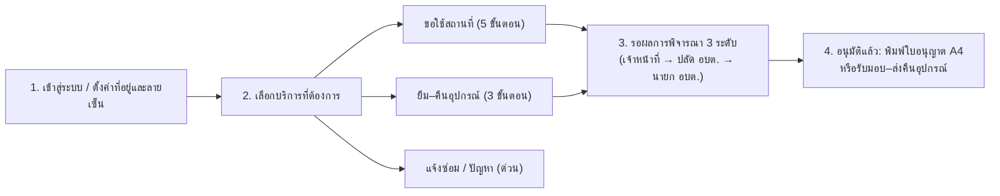

# คู่มือการใช้งานระบบสำหรับประชาชนและผู้ใช้งานทั่วไป (User Manual)
**ระบบบริการออนไลน์องค์การบริหารส่วนตำบล (Jongwen)**  
*ขอใช้สถานที่ราชการ · ขอยืม–คืนอุปกรณ์ · แจ้งซ่อมและติดตามสถานะ*

---

## สารบัญ
1. [ภาพรวมขั้นตอนการใช้งาน](#1-ภาพรวมขั้นตอนการใช้งาน)
2. [การลงทะเบียนและเข้าสู่ระบบ](#2-การลงทะเบียนและเข้าสู่ระบบ)
3. [การตั้งค่าบัญชีส่วนตัว ที่อยู่ และลายมือชื่อประจำตัว](#3-การตั้งค่าบัญชีส่วนตัว-ที่อยู่-และลายมือชื่อประจำตัว)
4. [การขอใช้สถานที่ราชการ (5 ขั้นตอน)](#4-การขอใช้สถานที่ราชการ-5-ขั้นตอน)
5. [การขอยืม–คืนอุปกรณ์ราชการ (3 ขั้นตอน)](#5-การขอยืมคืนอุปกรณ์ราชการ-3-ขั้นตอน)
6. [การแจ้งคืนอุปกรณ์เมื่อใช้งานเสร็จ](#6-การแจ้งคืนอุปกรณ์เมื่อใช้งานเสร็จ)
7. [การแจ้งซ่อมบำรุงและตรวจรับงานซ่อม](#7-การแจ้งซ่อมบำรุงและตรวจรับงานซ่อม)
8. [การติดตามสถานะ ขอเลื่อนวันเวลา ยกเลิก และพิมพ์ใบอนุญาต (PDF/A4)](#8-การติดตามสถานะ-ขอเลื่อนวันเวลา-ยกเลิก-และพิมพ์ใบอนุญาต-pdfa4)
9. [คำถามที่พบบ่อย (FAQ)](#9-คำถามที่พบบ่อย-faq)

---

## 1. ภาพรวมขั้นตอนการใช้งาน

---

## 2. การลงทะเบียนและเข้าสู่ระบบ

### 2.1 การลงทะเบียนผู้ใช้งานใหม่ (`/register`)
สำหรับประชาชนที่เข้าใช้งานครั้งแรก:
1. ไปที่หน้าเข้าสู่ระบบ แล้วกดปุ่ม **"ลงทะเบียน"**
2. กรอกข้อมูลส่วนตัว:
   - **ชื่อ–นามสกุล**
   - **เบอร์โทรศัพท์มือถือ** (ใช้เป็นชื่อผู้ใช้งานสำหรับเข้าสู่ระบบได้)
   - **หน่วยงาน / ชุมชน / กลุ่ม** (เช่น *กลุ่มแม่บ้านบ้านหนองบัว* หรือ *ประชาชนทั่วไป*)
   - **รหัสผ่าน** (ความยาวอย่างน้อย 8 ตัวอักษร ผสมตัวอักษรและตัวเลข)
3. กด **"ขอรหัส OTP"** และกรอกรหัสยืนยัน 6 หลัก *(ในโหมดทดสอบใช้รหัส `000000`)*
4. กดยืนยันการลงทะเบียน ระบบจะนำเข้าสู่หน้าแรกทันที

### 2.2 การเข้าสู่ระบบ (`/login`)
1. กรอก **ชื่อผู้ใช้ (Username)** หรือ **เบอร์โทรศัพท์** และ **รหัสผ่าน**
2. ติ๊กเครื่องหมายถูกที่ช่อง **"ยินยอมให้เก็บ ใช้ และเปิดเผยข้อมูลส่วนบุคคลตามนโยบาย PDPA"**
3. กดปุ่ม **"เข้าสู่ระบบ"**

---

## 3. การตั้งค่าบัญชีส่วนตัว ที่อยู่ และลายมือชื่อประจำตัว

> **คำแนะนำ:** แนะนำให้ตั้งค่า **ที่อยู่** และ **ลายมือชื่อประจำตัว** ในหน้าบัญชีก่อนยื่นคำขอ เพื่อให้ระบบดึงข้อมูลไปกรอกในแบบคำขอราชการให้อัตโนมัติทุกครั้ง ไม่ต้องพิมพ์ซ้ำ

กดที่เมนู **"จัดการบัญชีส่วนตัว"** ในแถบเมนูด้านซ้าย (หรือคลิกที่ชื่อของคุณมุมขวาบน) จะพบ 3 แท็บหลัก:

### แท็บที่ 1: ข้อมูลโปรไฟล์ & หน่วยงาน
- แก้ไข **ชื่อ-นามสกุล**, **ชื่อเล่น**, **หน่วยงาน / ชุมชน / สังกัด**, และ **เบอร์โทรศัพท์**
- กรอก **ที่อยู่ (สำหรับแบบคำขอราชการ)** ได้แก่:
  - **อยู่บ้านเลขที่**
  - **หมู่ที่**
  - **ตำบล / แขวง**
  - **อำเภอ / เขต**
  - **จังหวัด**
- กดปุ่ม **"บันทึกการเปลี่ยนแปลง"** — ข้อมูลชุดนี้จะถูกดึงไปใส่ในแบบขอใช้สถานที่และแบบคำขอใช้อุปกรณ์ให้อัตโนมัติ

### แท็บที่ 2: เปลี่ยนรหัสผ่าน (Password)
- กรอก **รหัสผ่านปัจจุบัน**
- กรอก **รหัสผ่านใหม่** และ **ยืนยันรหัสผ่านใหม่**
- กดปุ่ม **"บันทึกรหัสผ่านใหม่"**

### แท็บที่ 3: ลายมือชื่อ & รหัส PIN
- ใช้เมาส์หรือนิ้วมือเขียน **ลายมือชื่อ** ลงในกรอบสีขาว แล้วกด **"บันทึกลายมือชื่อประจำตัว"**
- เมื่อบันทึกลายมือชื่อไว้แล้ว เวลาทำเรื่องขอใช้สถานที่หรือยืมอุปกรณ์ คุณจะสามารถกดปุ่ม **"ใช้ลายเซ็นที่บันทึกไว้"** ได้ในคลิกเดียว

---

## 4. การขอใช้สถานที่ราชการ (5 ขั้นตอน)

กดที่เมนู **"ขอใช้สถานที่"** จากหน้าแรกหรือแถบเมนูด้านซ้าย:

### ขั้นตอนที่ 1: เลือกสถานที่
- ค้นหาหรือกรองตามประเภทสถานที่ (*ห้องประชุม, ศาลา, สนามกีฬา, ลานกิจกรรม*) และอาคาร
- แตะเลือกการ์ดสถานที่ที่ต้องการใช้งาน (สามารถเลือกได้มากกว่า 1 แห่งในคำขอเดียว เฉพาะสถานที่ที่ขึ้นสถานะ **"พร้อมใช้งาน"**)
- กดปุ่ม **"ถัดไป · เลือกวัน-เวลา"** ที่แถบด้านล่าง

### ขั้นตอนที่ 2: เลือกวัน-เวลา
- แตะเลือกวันที่ต้องการบนปฏิทิน (สังเกตจุดสีเขียว = ว่างมาก, สีเหลือง = เหลือน้อย)
- กำหนดเวลา **เริ่มต้น** และ **สิ้นสุด**
- หากต้องการขอใช้หลายวันหรือหลายช่วงเวลา กดปุ่ม **"+ เพิ่มช่วงเวลา"**
- ระบบจะตรวจสอบคิวว่างแบบอัตโนมัติ หากขึ้นป้ายสีเขียว **"ว่าง"** ให้กด **"ถัดไป · เลือกอุปกรณ์เสริม"**

### ขั้นตอนที่ 3: เลือกอุปกรณ์เสริม
- หากต้องการใช้อุปกรณ์ร่วมกับสถานที่ (เช่น *เครื่องเสียง, ไมโครโฟน, โปรเจกเตอร์, เต็นท์, โต๊ะ–เก้าอี้*) ให้กดปุ่ม **`+`** เพื่อระบุจำนวนที่ต้องการ
- หากไม่ต้องการใช้อุปกรณ์เสริม สามารถกด **"ถัดไป · กรอกคำขอ"** ข้ามไปได้เลย

### ขั้นตอนที่ 4: กรอกคำขอ (แบบขอใช้สถานที่ราชการ)
- ระบบจะดึง **ชื่อ-นามสกุล**, **ที่อยู่ (บ้านเลขที่, หมู่ที่, ตำบล, อำเภอ, จังหวัด)** และ **หน่วยงาน/ชุมชน** จากโปรไฟล์ของคุณมาใส่ให้อัตโนมัติ
- กรอกช่อง **เขียนที่** (เช่น *ที่ทำการ อบต.* หรือ *บ้านหนองบัว*), **ตำแหน่ง**, และ **จำนวนผู้เข้าร่วม (คน)**
- ในหมวด **"มีความประสงค์ขอใช้สถานที่ราชการ ดังนี้"**:
  - ระบบจะแสดงรายการสถานที่และอุปกรณ์เสริมที่คุณเลือกไว้ในขั้นตอนที่ 1 และ 3 พร้อมล็อกรายการไว้เพื่อความถูกต้องตรงตามคิวที่ตรวจสอบแล้ว *(หากต้องการเปลี่ยนสถานที่หรืออุปกรณ์ ให้กดย้อนกลับไปแก้ไขในขั้นตอนที่ 1 หรือ 3)*
- กรอก **รายละเอียด / วัตถุประสงค์เพิ่มเติม** และแนบไฟล์เอกสารประกอบ (ถ้ามี)
- กด **"ถัดไป · ลงนามและส่ง"**

### ขั้นตอนที่ 5: ลงนามและส่งคำขอ
- ตรวจสอบความถูกต้องของ **แบบขอใช้สถานที่ราชการ** บนหน้าจอ
- ลงลายมือชื่อผู้ขออนุญาตในกรอบด้านล่าง (เขียนใหม่ หรือกด **"ใช้ลายเซ็นที่บันทึกไว้"**)
- กดปุ่ม **"ส่งคำขอ"**

---

## 5. การขอยืม–คืนอุปกรณ์ราชการ (3 ขั้นตอน)

กดที่เมนู **"ยืม–คืนอุปกรณ์"** (สำหรับการยืมอุปกรณ์ไปใช้งานนอกสถานที่โดยไม่ได้จองห้องประชุม):

### ขั้นตอนที่ 1: เลือกอุปกรณ์
- ค้นหาหรือเลือกหมวดหมู่อุปกรณ์ (*เครื่องเสียง, เต็นท์/เก้าอี้, IT*)
- กดปุ่ม **`+`** / **`-`** เพื่อระบุจำนวนที่ต้องการยืม (ไม่เกินจำนวนคงเหลือในคลัง)
- กดปุ่ม **"ถัดไป · กรอกคำขอ"**

### ขั้นตอนที่ 2: กรอกคำขอ (แบบคำขอใช้อุปกรณ์ราชการ)
- ตรวจสอบหรือกรอก **เขียนที่**, **ข้าพเจ้า (นาย/นาง/นางสาว)**, **ตำแหน่ง**, **ที่อยู่ (บ้านเลขที่, หมู่ที่, ตำบล, อำเภอ, จังหวัด)** และ **หน่วยงาน/ชุมชน**
- ระบุ **วันที่รับอุปกรณ์** และ **กำหนดคืน**
- ตรวจสอบรายการในหมวด **"มีความประสงค์ขอใช้อุปกรณ์ราชการ ดังนี้"** (ล็อกตามอุปกรณ์และจำนวนที่เลือกในขั้นตอนที่ 1)
- กรอก **รายละเอียด / วัตถุประสงค์เพิ่มเติม** และแนบเอกสาร (ถ้ามี)
- กด **"ถัดไป · ลงนามและส่ง"**

### ขั้นตอนที่ 3: ลงนามและส่งคำขอ
- ตรวจสอบตัวอย่างเอกสาร **แบบคำขอใช้อุปกรณ์ราชการ**
- ลงลายมือชื่อผู้ขออนุญาตใช้อุปกรณ์ราชการ แล้วกด **"ส่งคำขอ"**

---

## 6. การแจ้งคืนอุปกรณ์เมื่อใช้งานเสร็จ

เมื่อคำขอยืมอุปกรณ์ได้รับการอนุมัติครบ 3 ระดับและเจ้าหน้าที่ส่งมอบอุปกรณ์ให้คุณแล้ว (สถานะคำขอเป็น **"กำลังยืม"**):
1. ไปที่เมนู **"รายการยืมของฉัน"** (`/borrow/my`) หรือดูจากการ์ดแจ้งเตือนกำหนดคืนใน **หน้าแรก**
2. เมื่อนำอุปกรณ์มาส่งคืนหรือพร้อมคืน ให้กดปุ่ม **"แจ้งคืนอุปกรณ์"**
3. สถานะจะเปลี่ยนเป็น **"รอตรวจรับคืน"** เพื่อให้เจ้าหน้าที่ตรวจเช็คสภาพอุปกรณ์และลงนามรับคืนร่วมกัน

---

## 7. การแจ้งซ่อมบำรุงและตรวจรับงานซ่อม

กดที่เมนู **"แจ้งซ่อม / ปัญหา"** (`/repair`):
- **ไม่ต้องลงลายมือชื่อดิจิทัล** เพื่อให้ประชาชนแจ้งเหตุชำรุดได้รวดเร็วที่สุด

### ขั้นตอนการแจ้งซ่อม:
1. เลือก **อาคาร**, **ชั้น**, และระบุ **จุดที่พบปัญหา** (เช่น *ห้องประชุมใหญ่ · เครื่องปรับอากาศ*)
2. เลือก **หมวดหมู่งานซ่อม** (เช่น *เครื่องปรับอากาศ, ไฟฟ้า/แสงสว่าง, ประปา, โสตทัศนูปกรณ์*)
3. กรอก **รายละเอียดอาการชำรุด** และระบุจำนวนภาพถ่ายประกอบ
4. กดปุ่ม **"ส่งเรื่องแจ้งซ่อม"**

### การตรวจรับงานเมื่อซ่อมเสร็จ:
- เมื่อเจ้าหน้าที่ดำเนินการซ่อมเสร็จแล้ว สถานะจะเปลี่ยนเป็น **"รอยืนยันรับงาน"**
- ให้เข้าดูรายการแจ้งซ่อมของคุณ แล้วกดปุ่ม **"ยืนยันตรวจรับงานซ่อม"** เพื่อปิดงาน

---

## 8. การติดตามสถานะ ขอเลื่อนวันเวลา ยกเลิก และพิมพ์ใบอนุญาต (PDF/A4)

คุณสามารถดูสถานะคำขอทั้งหมดได้ที่ **หน้าแรก (`/`)** หรือเมนู **"ประวัติคำขอทั้งหมด" (`/history`)**:

### ความหมายของสถานะคำขอ
| สถานะ | ความหมาย |
| :--- | :--- |
| **รอเจ้าหน้าที่ตรวจ** | คำขอถูกส่งแล้ว อยู่ระหว่างเจ้าหน้าที่ธุรการตรวจสอบความถูกต้อง |
| **รอปลัด อบต. พิจารณา** | เจ้าหน้าที่ตรวจผ่านแล้ว อยู่ระหว่างปลัดองค์การบริหารส่วนตำบลลงนามความเห็น |
| **รอนายก อบต. อนุมัติ** | ปลัด อบต. ลงนามแล้ว อยู่ระหว่างนายกองค์การบริหารส่วนตำบลมีคำสั่งอนุมัติ |
| **อนุมัติแล้ว** | ลงนามครบทั้ง 4 ฝ่ายเรียบร้อยแล้ว สามารถพิมพ์ใบอนุญาตไปใช้งานได้ทันที |
| **ไม่อนุมัติ** | คำขอไม่ผ่านการพิจารณา (สามารถดูเหตุผลได้ในหน้ารายละเอียดคำขอ) |

### การดำเนินการในหน้ารายละเอียดคำขอ (`/requests/[id]`)
- **ดูและพิมพ์เอกสารราชการ (A4 / PDF):** กดปุ่ม **"พิมพ์เอกสาร / บันทึก PDF"** เพื่อพิมพ์แบบขอใช้สถานที่หรือแบบคำขอใช้อุปกรณ์ที่มีลายเซ็นครบทุกฝ่าย
- **ขอเลื่อนวัน–เวลา:** สำหรับคำขอจองสถานที่ สามารถกดปุ่ม **"ขอเลื่อนวัน-เวลา"** เพื่อเลือกช่วงวันเวลาใหม่ (ระบบจะตรวจสอบคิวว่างและส่งให้เจ้าหน้าที่พิจารณาอีกครั้ง)
- **ยกเลิกคำขอ:** หากไม่ประสงค์ใช้งานแล้ว สามารถกดปุ่ม **"ยกเลิกคำขอ"** ได้ทันที

---

## 9. คำถามที่พบบ่อย (FAQ)

**Q: ทำไมในขั้นตอนที่ 4 ของการจองสถานที่ จึงแก้ไขชื่อสถานที่หรือจำนวนอุปกรณ์ในตารางไม่ได้?**  
**A:** ระบบล็อกรายการไว้ตามที่คุณเลือกในขั้นตอนที่ 1 (สถานที่) และขั้นตอนที่ 3 (อุปกรณ์เสริม) เพื่อให้ตรงกับผลตรวจสอบคิวว่างและสต็อกคงเหลือจริง หากต้องการเปลี่ยนสถานที่หรือเพิ่ม/ลดอุปกรณ์ สามารถกดปุ่ม **"ย้อนกลับ"** ไปปรับในขั้นตอนที่ 1 หรือ 3 ได้ทันที

**Q: ต้องกรอกที่อยู่ใหม่ทุกครั้งที่ยื่นคำขอหรือไม่?**  
**A:** ไม่ต้องกรอกใหม่ หากคุณบันทึกที่อยู่ไว้ที่เมนู **"จัดการบัญชีส่วนตัว"** ระบบจะดึงบ้านเลขที่ หมู่ที่ ตำบล อำเภอ และจังหวัด มาใส่ในแบบคำขอให้อัตโนมัติทุกครั้ง

**Q: คำขอต้องผ่านใครลงนามบ้างจึงจะสมบูรณ์?**  
**A:** เอกสารขอใช้สถานที่และขอยืมอุปกรณ์จะต้องมีลายมือชื่อครบ 4 ฝ่าย ได้แก่:  
1. ผู้ขออนุญาต (ประชาชน/ผู้ยื่นคำขอ)  
2. เจ้าหน้าที่ผู้ตรวจสอบ  
3. ปลัดองค์การบริหารส่วนตำบล  
4. นายกองค์การบริหารส่วนตำบล (ผู้มีคำสั่งอนุมัติ)

